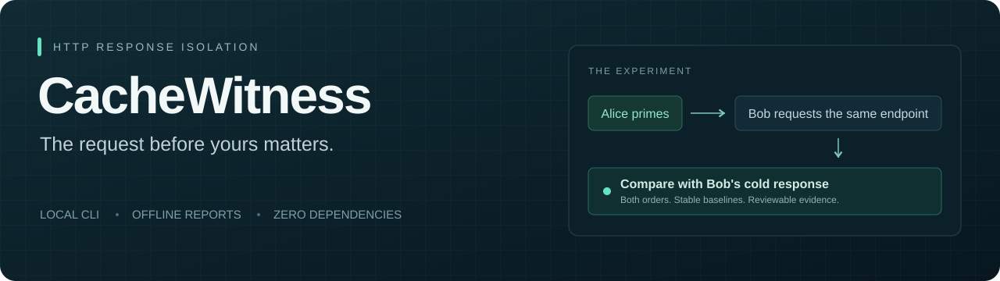
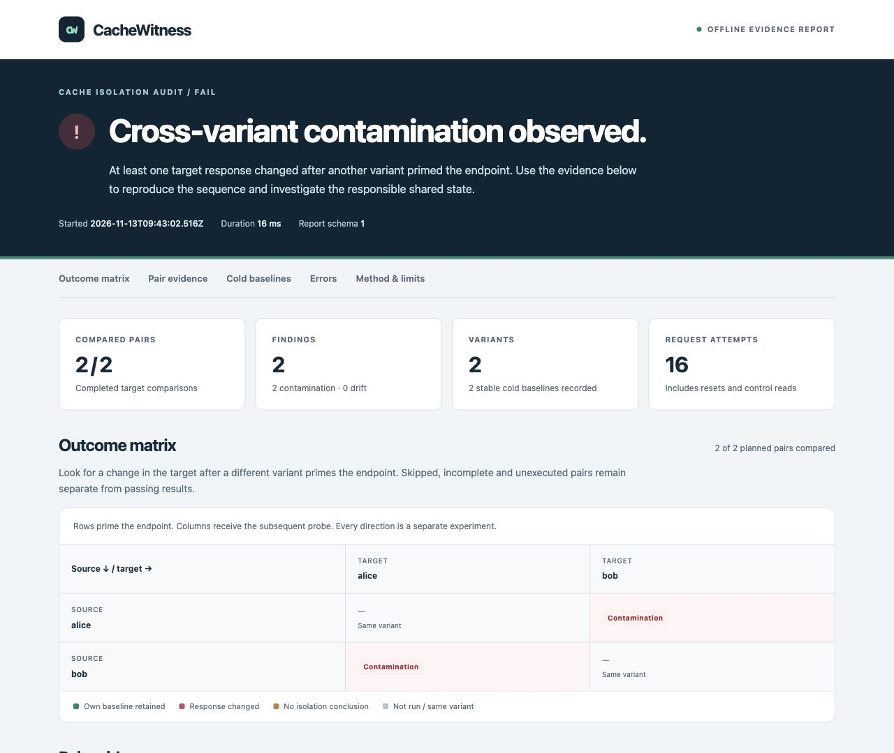

# CacheWitness



**Catch responses that cross user, tenant, or currency boundaries after another request primes the cache.**

[](https://github.com/godz1llla/cachewitness/actions/workflows/ci.yml)
[](https://github.com/godz1llla/cachewitness/releases)
[](https://nodejs.org/)
[](LICENSE)

Alice's test passes. Bob's test passes. Then Alice makes her request first, and Bob receives her dashboard.

CacheWitness repeats cold baselines, exercises both request orders, and records the difference. Run it locally or in CI; open the evidence in a standalone HTML report.

**Zero runtime dependencies · No account or model required · JSON + offline HTML · GitHub Action**

[Quick start](#try-it-in-30-seconds) · [Connect your app](#connect-your-application) · [GitHub Action](#add-a-check-to-github-actions) · [Methodology](docs/methodology.md)

## Try it in 30 seconds

Requires Node.js 22 or newer. Install the packaged CLI from GitHub Releases:

```sh
npm install --global https://github.com/godz1llla/cachewitness/releases/download/v0.2.0/godz1llla-cachewitness-0.2.0.tgz
cachewitness demo --html broken.html
```

Open `broken.html` in your browser. The demo starts a local synthetic server, finds a shared-key bug, and shuts the server down. **Exit code 1 is expected: the experiment found contamination.**

Now run the same experiment with the cache key fixed:

```sh
cachewitness demo --fixed --html fixed.html
```

This exits with code 0. Each tenant receives its own response. The package is distributed through GitHub Releases; it is not published to the npm registry.



Want to inspect the output first? Download the [broken-cache report](https://github.com/godz1llla/cachewitness/releases/download/v0.2.0/broken.html) or [fixed-cache report](https://github.com/godz1llla/cachewitness/releases/download/v0.2.0/fixed.html) and open it locally. Both use public synthetic fixtures.

## One small experiment, useful evidence

```text
Cold Alice → Alice's response       Cold Bob → Bob's response

Reset → Alice → Alice → Bob
                          └─ Did Bob still get Bob's response?
```

A missing request dimension in a cache key can expose another user's data, reuse the wrong tenant's settings, or return a price in the wrong currency. CacheWitness tests the observable effect through HTTP:

- **Repeated cold baselines** establish each variant's normal response.
- **Every ordered pair** exercises A → B and B → A separately.
- **Fingerprints and changed fields** identify which response differed without dumping its values.
- **An explicit incomplete verdict** prevents unstable or indistinguishable cases from passing silently.

The HTML report contains a pair matrix and evidence for individual checks. It is a single offline file, with no server required to open it. JSON output supports your existing CI tooling.

## Connect your application

Generate a configuration and choose the request dimension to vary:

```sh
cachewitness init --preset auth
# Also available: --preset tenant or --preset currency
```

Edit `cachewitness.json` to match your endpoint and test identities. Set the referenced environment variables, including the base URL and reset token. Then run:

```sh
cachewitness check cachewitness.json --output report.json --html report.html
```

You supply **one JSON GET endpoint and a synchronous reset endpoint**. The reset operation clears the relevant test cache before each baseline and request pair. Use a dedicated environment without competing traffic. Remote targets require `--allow-remote`.

[Integration guide](docs/integrations.md) includes the bundled local server, a test-only Express reset adapter, tenant and currency presets, and a CI example. The [configuration reference](docs/configuration.md) covers every field and option.

## Add a check to GitHub Actions

Check out your repository and start your test application first. Then add these steps:

```yaml
- name: Check response isolation
  id: cachewitness
  uses: godz1llla/cachewitness@v0.2.0
  with:
    config: cachewitness.json
  env:
    CACHEWITNESS_BASE_URL: http://127.0.0.1:3000
    CACHEWITNESS_ALICE_TOKEN: ${{ secrets.TEST_ALICE_TOKEN }}
    CACHEWITNESS_BOB_TOKEN: ${{ secrets.TEST_BOB_TOKEN }}
    CACHEWITNESS_RESET_TOKEN: ${{ secrets.TEST_RESET_TOKEN }}

- name: Keep the evidence
  if: always()
  uses: actions/upload-artifact@v7
  with:
    name: cachewitness-report
    path: cachewitness-reports/
```

The action sets up Node.js 22, writes JSON and HTML reports, and adds a job summary. A failing or incomplete audit fails the action. Your app remains responsible for its dependencies, fixtures, startup, and reset endpoint. See [action inputs and outputs](docs/integrations.md#github-action).

## Read the verdict

| Result | Meaning | Exit |
| --- | --- | --- |
| **Pass** | The target retained its stable response in every covered pair. | `0` |
| **Contamination** | The target changed to the source's cold response. | `1` |
| **Drift** | The target changed but matched neither baseline. | `1` |
| **Inconclusive** | Some baselines were unstable or could not be distinguished. | `2` |
| **Error** | Configuration, a request, or a response prevented a reliable audit. | `2` |

**A witness is evidence of a response change, not proof of its root cause.** Other shared state can produce the same behavior. A pass covers the supplied endpoint, variants, sequence, and compared fields; it does not prove universal isolation or confirm internal cache hits. [How the experiment works →](docs/methodology.md)

## What stays in a report

Reports omit raw response values, request credentials, reset bodies, and full URLs. They retain variant names, JSON property paths, fingerprints, and outcome metadata. Review those before sharing: names may be sensitive, and hashes are not anonymization. [Security and report handling →](SECURITY.md)

## Develop from source

```sh
git clone https://github.com/godz1llla/cachewitness.git
cd cachewitness
npm ci
npm test
npm run demo:fixed
```

Use `node bin/cachewitness.js` in place of `cachewitness` when running from a checkout. `npm run demo` deliberately exits with code 1. Contributions that add a reproducible scenario or improve verdict accuracy are welcome; see [CONTRIBUTING.md](CONTRIBUTING.md).

[MIT license](LICENSE) · [Changelog](CHANGELOG.md) · [Report a bug](https://github.com/godz1llla/cachewitness/issues/new/choose)
