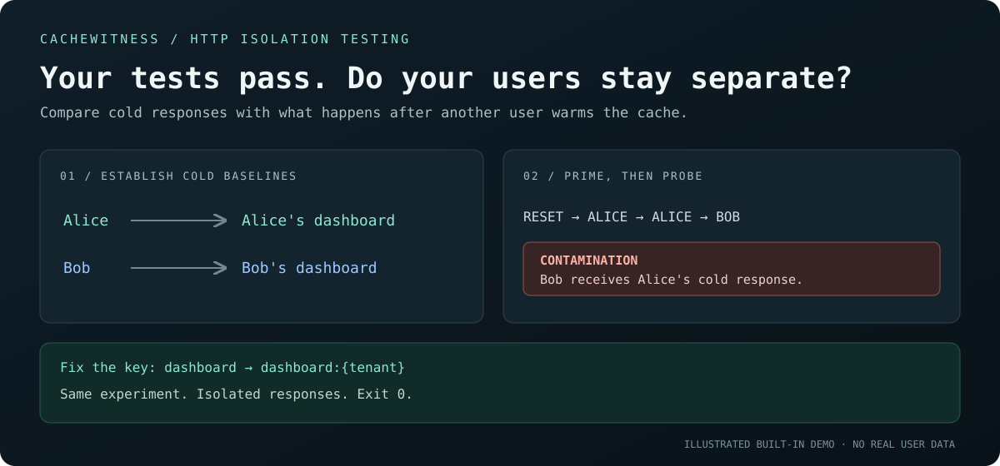

# CacheWitness

**Find HTTP responses that change when a different user warms the cache.**

[](https://github.com/godz1llla/cachewitness/actions/workflows/ci.yml)
[](https://nodejs.org/)
[](LICENSE)

A test can pass for Alice and pass for Bob, yet fail when Alice makes her request first. A shared cache key can cause Bob to receive Alice's dashboard, another tenant's settings, or a price in the wrong currency.

CacheWitness runs those requests in both orders and compares them with repeatable cold baselines. It gives you a small, reproducible witness: **who primed the response, who received it, and which JSON fields changed**.

Zero runtime dependencies. Local CLI. JSON reports for CI. No model, account, or API key required.



## Try the broken and fixed versions

Requires Node.js 22 or newer and Git.

```sh
git clone https://github.com/godz1llla/cachewitness.git
cd cachewitness
npm ci
npm run demo
```

The demo starts an isolated local HTTP server with an intentionally incorrect cache key, audits it, and shuts it down. **Exit code 1 is the expected result:** CacheWitness found contamination.

```sh
npm run demo:fixed
```

The fixed demo includes the user's identity in the cache key. The same audit passes with exit code 0.

```text
Cold request as Alice ────────────► Alice's response
Cold request as Bob ──────────────► Bob's response

Reset → Alice → Alice → Bob ──────► Alice's response reaches Bob
                                   ^ contamination witness
```

The second priming request checks that the source response stays stable. The audit also tries the reverse order.

To try the configuration-file workflow, start the included server in one terminal:

```sh
npm run example:server
```

In a second terminal, use the included synthetic fixture variables:

```sh
node --env-file=examples/demo.env bin/cachewitness.js check examples/cachewitness.json --output report.json
```

This intentionally returns exit code 1. Stop the server with Ctrl-C, restart it using `npm run example:server -- --fixed`, and run the same check again to see a pass. The bundled environment file contains public demo values, not credentials for a real service.

## Check your application

Use a dedicated test environment with an explicit endpoint that clears the cache involved in the scenario. CacheWitness calls this endpoint repeatedly. Keep other traffic away while the audit runs.

Save a JSON configuration as `cachewitness.json`:

```json
{
  "baseUrl": "${CACHEWITNESS_BASE_URL}",
  "request": {
    "path": "/api/dashboard"
  },
  "variants": [
    {
      "name": "alice",
      "headers": { "Authorization": "Bearer ${CACHEWITNESS_ALICE_TOKEN}" }
    },
    {
      "name": "bob",
      "headers": { "Authorization": "Bearer ${CACHEWITNESS_BOB_TOKEN}" }
    }
  ],
  "reset": {
    "path": "/__test/reset-cache",
    "method": "POST"
  },
  "ignore": ["/requestId"]
}
```

Set the referenced environment variables to your test server and test credentials, then run:

```sh
node bin/cachewitness.js check cachewitness.json --output report.json
```

Use `--json` for machine-readable stdout. Remote hosts require an explicit `--allow-remote`; only use this with an environment you control and intend to reset.

Variant headers override common request headers. Variants can also supply query parameters, making the same workflow useful for language, currency, plan, or tenant isolation.

See the [configuration reference](docs/configuration.md) for the complete schema and examples.

## Understand the result

| Result | What was observed | Exit code |
| --- | --- | --- |
| `pass` | Every covered pair returned the target's stable baseline after priming. | `0` |
| `fail` · contamination | The target changed to the source's cold response. | `1` |
| `fail` · drift | The target changed, but did not match the source's cold response. | `1` |
| `inconclusive` | Baselines were unstable or some variants could not be distinguished. | `2` |
| `error` | A request, reset, response, or configuration prevented the audit from completing. | `2` |

A successful audit applies only to the supplied endpoint, variants, reset behavior, and comparison fields. Identical baselines are **inconclusive**, not evidence that isolation works.

## What makes this useful

- **Sequence matters.** Every ordered pair is exercised; Alice → Bob can behave differently from Bob → Alice.
- **Cold baselines first.** Each variant is checked repeatedly with a reset before each baseline request.
- **Evidence without response dumps.** Reports contain fingerprints and changed JSON pointers, not raw response values or authorization headers.
- **A CI-friendly verdict.** An incomplete check never reports a pass.
- **Works at the HTTP boundary.** No Redis credentials or application instrumentation are required. You supply the reset adapter.

CacheWitness tests an isolation property. It does not discover all endpoints, infer your application's authorization rules, inspect Redis keys, or prove that a cache caused the observed behavior. Other shared state can produce the same witness. The [methodology](docs/methodology.md) explains the checks and their limits.

Responses must be JSON with representable numeric values. Unsafe integers and non-finite numbers produce an `unsupported_json_number` error; encode large identifiers as strings. See the [response constraints](docs/configuration.md#response-constraints).

## Use in CI

Start your test application, provide test credentials through your CI's secret mechanism, then run:

```sh
node bin/cachewitness.js check cachewitness.json --output artifacts/cachewitness.json
```

Let its exit code fail the job. Keep reports as job artifacts according to your team's access and retention policy. Do not run the same resettable environment in parallel with other tests.

## Report privacy

Response bodies are compared in memory. Reports exclude raw response values, request headers, reset bodies, and full URLs. Variant names and JSON property names are still visible. Fingerprints are deterministic hashes, **not encryption or anonymization**; low-entropy values may be guessable. Review reports before sharing them publicly. See [SECURITY.md](SECURITY.md).

## Development

```sh
npm ci
npm test
```

Bug reports with a small reproduction are welcome. A useful contribution is a scenario that the audit gets wrong, with the expected verdict and an explanation. See [CONTRIBUTING.md](CONTRIBUTING.md).

## License

[MIT](LICENSE).
